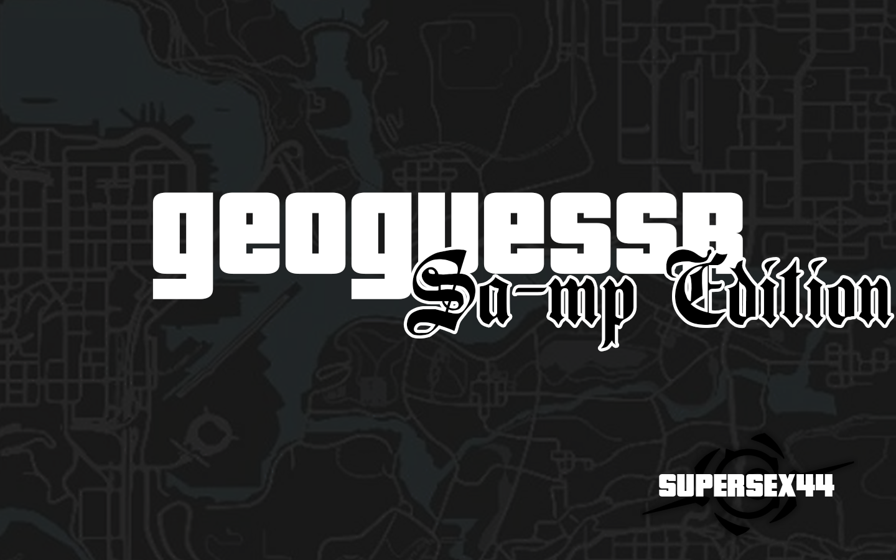

# geoguessr-samp-edition

# Descripción
Es el clásico juego de orientarte y marcar en un mapa dónde creés estés ubicado. Adaptado a SAMP.

# Características
Por default son 5 rondas en las cuales habrá que adivinar dónde está la cámara del juego. El jugador tiene 30s para memorizar el área y otros 30s para apretar ESC y marcar en su mapa. Para posteriormente usar el comando ``/confirmar``. Al finalizar una ronda se verá el resultado, y en base a eso se sumará con el resto de rondas.

# Vídeos / Imágenes
[](https://youtu.be/y_VzLU_7RqA)
# Configuración
```
//Dónde se guardan todas las locaciones del minijuego. Importante que almenos exista una línea.
#define GEO_ARCHIVO             "geoguesser_locaciones.txt"

//Rondas por partida
#define GEO_RONDAS              5

//Habilita el crear nuevas locaciones ingame.
#define DEBUG

//Fase 1 para mirar, Fase 2 para marcar en el mapa. Mientras menos más dificultad.
#define GEO_TIEMPO_OBSERVAR     30
#define GEO_TIEMPO_ADIVINAR     30

//Ticks del fader para cambiar de fase.
#define GEO_FUNDIDO_PASOS       10

//Oculta el minimapa al ususario.
#define GEO_NIVEL_HUD           5000

//Lugar dónde se posicionará el jugador durante la pantalla en negro.
#define GEO_SENUELO_X           0.0
#define GEO_SENUELO_Y           0.0
#define GEO_SENUELO_Z           0.0

//Segundos en que se muestran los resultados.
#define GEO_PAUSA_RESULTADO     12

//Puntos máximos.
#define GEO_PUNTOS_MAX          5000

//Precisión del marcado
#define GEO_ESCALA_DISTANCIA    900.0

//Radio que marca si es lo más cerca posible de la cámara objetivo.
#define GEO_RADIO_PERFECTO      40.0

//Gangzone
#define GEO_TAM_ZONA            100.0 

//1 Marca en el mapa y usa el CMD /confirmar 0 clickea en el mapa y continúa.
#define GEO_CONFIRMAR_MANUAL    1

//VW en que se ejecuta el minijuego.
#define GEO_MUNDO_BASE          7000

//Máximo de rondas
#define GEO_RONDAS_MAX          10

//Número máximo de locaciones que se van a leer en el .txt
#define MAX_LOCACIONES          200
```


# Changelog
- 11/11/26 Se resolvieron problemas de lógica, y sobre cómo teleportar al jugador fuera del área cuando deba marcar en el mapa.
- 10/11/26 Creación oficial del Filterscript

# Dependencias
[zcmd](https://github.com/Southclaws/zcmd)
[foreach](https://github.com/karimcambridge/samp-foreach/blob/master/foreach.inc)

# Créditos
 - SUPERSEX44